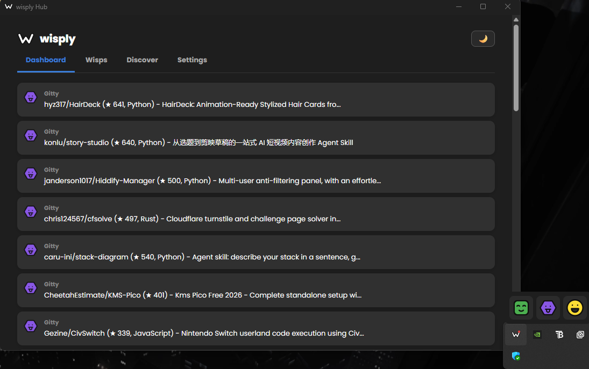

# Wisply

Small, single-purpose helpers ("wisps") that live in your Windows system tray and quietly bring you the things you care about: game deals, interesting GitHub projects, and reminders from a friendly companion.

> Status: early alpha (v0.1). Windows only.

<!-- Add a screenshot of the tray pop-up and the Hub here, for example:  -->

## Why Wisply?

Checking a handful of sites for the things you care about is a chore, and most apps that do it for you are heavy, noisy or need an account. Wisply does one small job per wisp, checks in the background, and only shows a red dot on its tray icon when something new turns up. Everything stays on your computer.

## The wisps

| Wisp | What it does |
| --- | --- |
| **Weaver** | Watches game deals (via CheapShark) and shows new ones. |
| **Gitty** | Finds interesting GitHub projects (via GitHub search). |
| **pip** | Your companion: reminders, ideas and a daily greeting in a warm voice. |

Each wisp can be switched on or off, renamed, recoloured, and given its own check interval.

## Features

- **Tray pop-up:** click the tray icon for a small window with your wisps and their newest items; click an item to open it.
- **Hub:** the main window, with Dashboard, Wisps, Discover and Settings tabs.
- **Quick add:** add an idea or a reminder from the tray menu, without opening the Hub.
- **Notifications:** desktop toasts when something new is found, and a red dot on the tray icon for anything unread.
- **Start with Windows** (optional), starting quietly in the tray.
- **Private by design:** local database, no account, no tracking. Text from the internet is cleaned and links are checked before they reach your screen.

## Install

1. Download the installer (`Wisply_..._x64-setup.exe`) from the Releases page.
2. Run it. It installs for your user only, so it does not ask for administrator rights.
3. Because the alpha is not code-signed yet, Windows may show "Windows protected your PC". Click **More info**, then **Run anyway**.
4. Wisply starts and opens the Hub. Closing the Hub keeps Wisply running in the tray; quit it from the tray menu.

Your data lives in `%APPDATA%\Wisply` (Settings has an "Open data folder" button).

### Coming from the Python version?

The first start of the new app imports your old `data.db` automatically when it sits next to the new database, and never changes the old file. To redo the import: quit Wisply, back up `wisply.db`, delete `wisply.db` (and `wisply.db-wal`, `wisply.db-shm` if present), keep `data.db`, and start Wisply again. The last Python version is kept at the git tag `python-final`.

## Build from source

You need [Rust](https://rustup.rs), the Tauri CLI (`cargo install tauri-cli --version "^2"`), Microsoft WebView2 (already on Windows 11) and Git.

```
git clone https://github.com/mdcue/wisply.git
cd wisply
cargo tauri dev        # run for development
cargo tauri build      # build the installer (target\release\bundle\nsis\)
```

## Tests

```
cargo test -p wisply-core
cargo clippy --workspace --all-targets
```

The core crate holds all the logic and has no windows, so almost everything is covered by automated tests (210 at the time of writing).

## How it is built

- **Tauri 2** shell (Rust) with a WebView2 front end written in plain HTML, CSS and JavaScript.
- **`crates/core`** (`wisply-core`): scheduler, wisps, SQLite storage, safe-text and link checks, icon drawing, logging.
- **`src-tauri`**: the tray, windows, commands and notifications.
- **`ui`**: the Hub, pop-up and quick-add pages.

The rewrite from Python/PyQt6 cut the installer from hundreds of megabytes to a few megabytes.

## Roadmap

- Countdowns and a quote or fact of the day for pip
- Trending by topic for Gitty
- A new Dev News wisp
- A UI refresh

## Privacy

Wisply keeps everything in a local database on your computer. It contacts only the services its wisps use (currently CheapShark and GitHub) and sends no personal data.

## Licence

To be decided before the first public release.